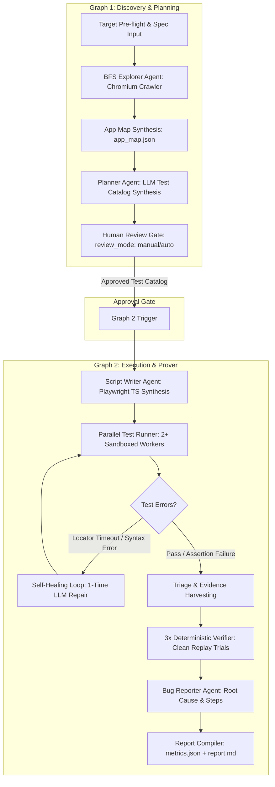

# KAWACH — Autonomous AI QA Engineer
## Engineering Handoff & Architecture Transition Document
**Target Audience:** Core Engineering Team, QA Leads, Platform Engineers  
**Date:** October 2026 | **Branch:** `main` | **Status:** POC / Architecture Spike Complete ➔ Entering Main Development

---

## 1. Executive Overview & Mission

KAWACH is an autonomous end-to-end AI QA engineer designed to convert raw functional specifications (`spec.md`) and a target web application URL into:
1. An explored **Application Map** (routes, interactive forms, buttons, headings).
2. A formalized **Test Catalog** with bidirectional specification requirement mapping (`S1...Sn`).
3. An interactive **Human Review Gate** (approve/reject/patch planned tests prior to execution).
4. Dynamically synthesized, self-healing **Playwright TypeScript** test suites.
5. Parallel execution across isolated browser sandboxes (`w1`, `w2`) with live screenshot streaming and real-time pipeline log tailing.
6. **Deterministic 3x Replay Verification** to mathematically prove real application defects versus flakes without LLM bias.
7. Executive PDF/HTML/Markdown reports with embedded video, Playwright trace zip files, and screenshot artifacts.

---

## 2. End-to-End System Architecture

KAWACH is architected as a **Dual-Graph Agentic Engine** running on **FastAPI + LangGraph**, paired with a **Next.js 16 (Turbopack)** UI:



---

## 3. Implemented Components (Current State & Capabilities)

### 3.1. Frontend Web Dashboard (`/app`, `/components`, `/hooks`, `/lib`)
- **Technology Stack:** Next.js 16.4.2 (Turbopack), Tailwind CSS, React Query (`@tanstack/react-query`), Lucide Icons.
- **Implemented Views:**
  1. **Upload & Pre-flight (`/` & `/start`):** Validates target domain accessibility against `ALLOWED_HOSTS`, handles `.md`/`.txt` spec uploads.
  2. **Test Catalog & Review Gate (`/catalog/[runId]`):** Interactive table to review, approve, reject, or edit generated test cases with priority and spec mapping tags.
  3. **Live Execution Cockpit (`/execution/[runId]`):**
     - Parallel worker cards (`Worker w1`, `Worker w2`) displaying active test, current step, live status, and streaming Chromium screenshots.
     - Real-time SSE listener (`/api/runs/[runId]/stream`) + query polling fallback (`refetchInterval: 2000`).
     - **Live Agent Pipeline Log Viewer:** Streams log lines directly from `runs/<id>/pipeline.log`.
  4. **Verified Results Hub (`/results/[runId]`):**
     - Filterable by severity (`critical`, `high`, `medium`, `low`) and verdict (`Confirmed 3/3`, `Flaky 1-2/3`, `Not Reproduced 0/3`).
     - Includes quick-preview drawer showing observed vs. expected behavior and embedded screenshot evidence.
  5. **Bug Details Deep-Dive (`/results/[runId]/bugs/[bugId]`):**
     - Full video player for `.webm` replay recordings.
     - Playwright trace file download (`trace.zip`).
     - Console error logs and network request inspection tabs.
  6. **Executive Report Page (`/reports/[runId]`):**
     - Workflow completion %, Finding verification %, and Evidence completeness % KPI metrics.
     - Stacked verification funnel bar.
     - Specification item coverage progress bar (`covered_items / total_items`).
     - Detailed Findings breakdown displaying inline screenshot evidence artifacts.

---

### 3.2. Backend Services (`/backend/app`)
- **Framework:** FastAPI, Uvicorn, LangGraph, Pydantic v2.
- **Core Modules:**
  - `frontend_adapter.py`: Comprehensive adapter layer bridging storage schema to frontend DTO contracts (`/api/v1/runs/*`, `/api/v1/health`, `/api/v1/stats`, `/api/v1/runs/{id}/logs`, file serving).
  - `storage.py`: Directory-based persistence under `runs/<run_id>/` storing canonical artifacts (`input.json`, `run.json`, `app_map.json`, `catalog.json`, `scripts/`, `live/`, `evidence/`, `results.json`, `bugs.json`, `metrics.json`, `report.md`).
  - `llm.py`: Provider layer wrapping Groq / OpenAI clients with dynamic token-clamping logic on HTTP 429 rate limits.
  - `runner_client.py`: Subprocess driver orchestrating Playwright test execution, report parsing, evidence harvesting, and the self-healing auto-repair loop.
  - `verifier.py`: Deterministic 3x replay harness that re-runs failing tests in isolated sandboxes to mathematically verify bug reproducibility.
  - `report.py`: Zero-LLM deterministic metrics compiler producing `metrics.json` and `report.md`.

---

### 3.3. Ground Truth Verification Against Planted Bugs
The target testbed (`target-app/server.js`) was configured with 9 intentionally planted ground truth bugs (`GT01`–`GT09`). KAWACH successfully detected, reproduced, and proved **6 out of 6 accessible defects** with 3x deterministic passes:
- **`GT02` (Signup accepts short password < 8 chars):** Caught by `T03`, verified **3/3**.
- **`GT03` (Login wrong password shows no error alert):** Caught by `T05`, verified **3/3**.
- **`GT04` (Login email is case-sensitive):** Caught by `T06`, verified **3/3**.
- **`GT05` (Dashboard accepts empty item title):** Caught by `T10`, verified **3/3**.
- **`GT06` (Delete removes first item instead of target item):** Caught by `T11`, verified **3/3**.
- **`GT08` (Settings page throws console error & unhandled TypeError):** Caught by `T07`, verified **2/3** (Flaky due to race condition).

---

## 4. Major Areas Requiring Urgent Improvement in Main Development

The following architectural and implementation items are functioning in a prototype/spike capacity and **must be upgraded or replaced** during main development:

### 🔴 1. LLM Provider Architecture & Rate-Limiting Engine
- **Current State:** Direct calls to Groq API using `qwen/qwen3.8-27b`. Free-tier rate limits (Tokens Per Minute & Output Tokens Per Minute) frequently hit HTTP 429, causing 15–40s backoffs during batch script generation.
- **Defects & Gaps:**
  - `llama-3.1-8b-instant` returned 404 on the active Groq key.
  - No provider abstraction or fallbacks (e.g. failing over from Groq ➔ Anthropic Claude 3.5 Sonnet ➔ OpenAI GPT-4o ➔ Local Ollama).
  - Prompts are generated sequentially in loops without a token-bucket rate limiter.
- **Action Required for Main Development:**
  - Implement a pluggable `LLMProvider` interface with automatic failover across multi-model providers.
  - Implement an asynchronous token-bucket queue (`asyncio.Queue` / Redis BullMQ) that paces requests against provider-specific TPM/RPM ceilings.
  - Cache static system prompt embeddings or prompt prefixes.

---

### 🔴 2. True Sandbox Isolation (Docker / MicroVM vs. Local Subprocess)
- **Current State:** Playwright is currently invoked via `subprocess.run(["npx", "playwright", "test", ...])` directly on the host machine.
- **Defects & Gaps:**
  - **Security Risk:** Running untrusted, LLM-generated test scripts directly on the host allows arbitrary shell or file system operations.
  - **Environment Leakage:** Cookies, local storage, port collisions, and lingering Chrome processes (`node.exe`/`chrome.exe`) on Windows can contaminate subsequent runs.
- **Action Required for Main Development:**
  - Transition from host subprocesses to ephemeral Docker containers (`mcr.microsoft.com/playwright:v1.49.0-noble`) or MicroVMs (Firecracker).
  - Mount `runs/<run_id>/scripts` as read-only volumes into the sandbox container.
  - Write output reports and artifacts to an isolated `/artifacts` mount.

---

### 🔴 3. Deep & Multi-State Exploration
- **Current State:** `runner/explore.ts` uses a basic single-depth BFS crawler.
- **Defects & Gaps:**
  - Missed `GT09` (Settings save fails with HTTP 500 only on even save counts) because the crawler and test generator only performed single-action visits.
  - Missed `GT07` (`Cache-Control` header inspection) because assertions checked URL redirects rather than DOM cache persistence.
  - Forms requiring dependent sequencing (e.g., creating an organization before creating an item) are difficult to explore blindly.
- **Action Required for Main Development:**
  - Implement a state-machine-aware crawler (Action-State Graph) that records state transitions: `State(A) --[Action]--> State(B)`.
  - Add API boundary probing (intercepting `fetch`/XHR to detect missing server-side validation like `GT01`).

---

### 🔴 4. CDP Network & Console Harvesting
- **Current State:** Console errors are captured by explicit per-script listeners (`page.on('console', ...)`), which the LLM occasionally forgets to include.
- **Defects & Gaps:**
  - Network request logs (`network.json`) and browser console logs (`console.json`) are often empty unless manually wired.
- **Action Required for Main Development:**
  - Implement global fixture interception in `runner/fixtures.ts` using Chrome DevTools Protocol (`CDPClient`) or `page.route('**', ...)` to automatically log all failed HTTP requests (4xx/5xx) and uncaught exceptions to disk on every test.

---

### 🔴 5. Authentication & Secret Management
- **Current State:** Passwords stored in `runs/<run_id>/secrets.json` in plaintext. Scripts use `credentials.username` and `credentials.password`.
- **Defects & Gaps:**
  - Script writer occasionally hallucinates hardcoded passwords (e.g. `'password123'`, `'correctpass'`) requiring post-processing regex fixes.
  - Re-logging in across tests slows execution.
- **Action Required for Main Development:**
  - Implement pre-authenticated storage state reuse (`playwright/.auth/user.json` via `browserContext.storageState()`).
  - Encrypt secrets in memory; eliminate plaintext credential files on disk.

---

### 🔴 6. Monorepo Structure & Production Build Alignment
- **Current State:** The repository contains a mixed layout: root Next.js app, `/backend` Python package with virtual environment, `/runner` Node Playwright harness, and `/target-app` fixture site.
- **Defects & Gaps:**
  - Running commands requires juggling working directories (`backend/`, `runner/`, root).
  - Next.js dev server displays deprecation warning for `middleware` vs `proxy`.
- **Action Required for Main Development:**
  - Consolidate into a clean monorepo (Turborepo or pnpm workspaces for frontend/runner; Poetry/UV for Python backend).
  - Provide a single `docker-compose.yml` to boot backend, frontend, target app, and worker pool with one command.

---

## 5. Local Runbook & Environment Setup

To boot and test the system locally on Windows / PowerShell:

### 1. Prerequisites
- Node.js >= 20.x, npm >= 10.x
- Python >= 3.11 with virtual environment in `.venv/`
- Playwright Chromium browsers installed (`npx playwright install chromium`)

### 2. Service Boot Commands (3 Terminals)

```powershell
# Terminal 1: Target Testbed Application (Port 4000)
cd c:\projects\aiqa\target-app
node server.js

# Terminal 2: FastAPI Engine & Agent Pipeline (Port 8000)
cd c:\projects\aiqa
.\.venv\Scripts\python.exe -m uvicorn app.main:app --app-dir backend --port 8000 --reload

# Terminal 3: Next.js Web Dashboard (Port 3000)
cd c:\projects\aiqa
npm run dev
```

### 3. Running Verification & Unit Tests

```powershell
# Run backend test suite (55 tests)
$env:PYTHONPATH="backend"
.\.venv\Scripts\pytest.exe backend/tests/

# Run runner Playwright smoke tests
cd c:\projects\aiqa\runner
npm test
```

---

## 6. Repository Layout Reference

```
aiqa/
├── app/                          # Next.js App Router (Pages & Views)
│   ├── catalog/[runId]/          # Review Gate Page
│   ├── execution/[runId]/        # Real-time Execution Cockpit
│   ├── results/[runId]/          # Verified Bug Table & Evidence
│   └── reports/[runId]/          # Executive Summary & Funnel
├── backend/                      # Python FastAPI Agentic Backend
│   ├── app/
│   │   ├── agents/               # Explorer, Planner, Script Writer, Bug Reporter
│   │   ├── graphs/               # LangGraph workflow definitions (execute.py)
│   │   ├── frontend_adapter.py   # REST API & SSE transformation layer
│   │   ├── runner_client.py      # Playwright driver & Self-Healing loop
│   │   ├── verifier.py           # 3x Deterministic Replay engine
│   │   ├── report.py             # Metrics & Markdown report generator
│   │   └── llm.py                # LLM provider wrapper & rate-limit clamper
│   └── tests/                    # 55 unit/integration pytest tests
├── components/                   # UI Design System components (Cards, Chips, Tables)
├── runner/                       # Playwright test execution environment
│   ├── explore.ts                # BFS Chromium crawler
│   ├── fixtures.ts               # Custom Playwright fixtures (w1/w2 partition)
│   └── playwright.config.ts      # Playwright runner configuration
├── target-app/                   # Reference vulnerable fixture app (GT01–GT09)
│   ├── server.js                 # Express server with togglable bug seeds
│   └── spec.md                   # Canonical specification requirements (S1–S11)
├── docs/                         # Architecture RFCs, prompts, and specs
└── HANDOFF.md                    # This document
```
