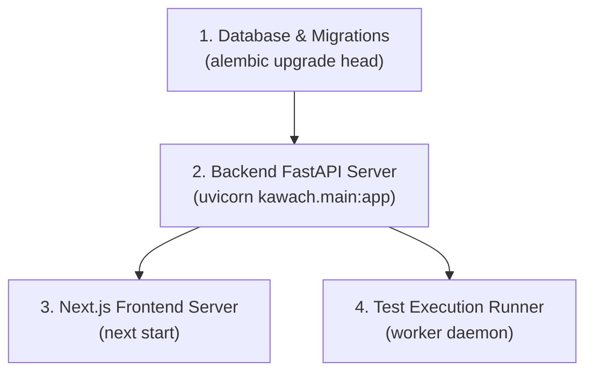

# Kawach Production Deployment Checklist & Multi-Server Runbook

**Document Version:** 1.0  
**Target Architecture:** Multi-host / Multi-container Distributed Deployment  
- Frontend: Next.js 16 (`apps/web`)  
- Backend API: FastAPI (`apps/api`)  
- Test Execution Runner: Playwright / Chromium (`apps/runner`)  
- Database: SQLite / PostgreSQL with Alembic migrations  

---

## 1. Environment Variables Matrix

Mask all secrets in CI/CD logs. Never commit live tokens or credentials.

### Backend API (`apps/api`)

| Variable | Required | Default / Example | Purpose |
|---|---|---|---|
| `DATABASE_URL` | Yes | `sqlite:///./kawach.db` or `postgresql+asyncpg://...` | Database connection string |
| `SECRET_KEY` | Yes | `generate-with-openssl-rand-hex-32` | JWT signing and cookie protection |
| `ENCRYPTION_KEY` | Yes | `32-byte-base64-fernet-key` | Encrypts target app passwords at rest |
| `FRONTEND_URL` | Yes | `https://kawach.example.com` | Allowed CORS origin & redirect validation |
| `ALLOWED_ORIGINS` | No | `http://localhost:3000,https://kawach.example.com` | Comma-separated CORS origins |
| `ENV` | Yes | `production` (or `development`) | Disables system user fallbacks in prod |
| `ALLOW_SYSTEM_USER_FALLBACK` | No | `false` | Must remain `false` in production |
| `GROQ_API_KEY` | Conditional | `gsk_...` | LLM planning and exploratory agent |
| `OPENAI_API_KEY` | Conditional | `sk-...` | Alternative LLM provider |
| `RUNS_DIR` | No | `/var/lib/kawach/runs` | Persistent storage for run artifacts & logs |

### Frontend Web (`apps/web`)

| Variable | Required | Default / Example | Purpose |
|---|---|---|---|
| `BACKEND_URL` | Yes (Server) | `http://api.internal:8000` | Target URL used by Next.js server rewrites (`/api/:path*`) |
| `NEXT_PUBLIC_API_URL` | No | Relative `/api` (recommended) | Client-side base URL; keep relative to utilize cookie proxying |
| `NODE_ENV` | Yes | `production` | Enables Next.js production optimizations |

### Runner Engine (`apps/runner`)

| Variable | Required | Default / Example | Purpose |
|---|---|---|---|
| `API_URL` | Yes | `http://api.internal:8000` | Backend endpoint for worker heartbeat & reporting |
| `RUNNER_API_TOKEN` | Yes | `kw_live_...` | Token with `runs:write` and `workers:heartbeat` scopes |
| `HEADLESS` | No | `true` | Browser execution mode |

---

## 2. Startup Order & Initialization Sequence

To prevent connection drops or schema race conditions, enforce this startup order:



1. **Step 1: Database Migration Gate**
   ```bash
   cd apps/api
   alembic upgrade head
   # Verify current revision matches heads
   alembic current
   ```
2. **Step 2: Start Backend API**
   ```bash
   cd apps/api
   uvicorn kawach.main:app --host 0.0.0.0 --port 8000 --workers 4
   ```
3. **Step 3: Start Frontend Web Service**
   ```bash
   cd apps/web
   npm run build
   npm run start -- -p 3000
   ```
4. **Step 4: Start Runner Workers**
   ```bash
   cd apps/runner
   python -m runner.worker --concurrency 2
   ```

---

## 3. Reverse Proxy & Ingress Configurations

When hosting frontend and backend across different ports, VMs, or subdomains, configure Nginx or Caddy to ensure cookies, headers, and SSE streaming work seamlessly.

### Nginx Configuration (`/etc/nginx/sites-available/kawach.conf`)

```nginx
upstream frontend_upstream {
    server 127.0.0.1:3000;
    keepalive 32;
}

upstream backend_upstream {
    server 127.0.0.1:8000;
    keepalive 32;
}

server {
    listen 443 ssl http2;
    server_name kawach.example.com;

    ssl_certificate /etc/letsencrypt/live/kawach.example.com/fullchain.pem;
    ssl_certificate_key /etc/letsencrypt/live/kawach.example.com/privkey.pem;

    # 1. API Calls & SSE Streaming forwarded directly to Backend
    location /api/ {
        proxy_pass http://backend_upstream;
        proxy_http_version 1.1;

        # Header forwarding
        proxy_set_header Host $host;
        proxy_set_header X-Real-IP $remote_addr;
        proxy_set_header X-Forwarded-For $proxy_add_x_forwarded_for;
        proxy_set_header X-Forwarded-Proto $scheme;

        # SSE Streaming Optimization (CRITICAL: disable buffering)
        proxy_set_header Connection '';
        proxy_buffering off;
        proxy_cache off;
        proxy_read_timeout 86400s;
        chunked_transfer_encoding on;
    }

    # 2. Next.js Frontend UI
    location / {
        proxy_pass http://frontend_upstream;
        proxy_http_version 1.1;
        proxy_set_header Upgrade $http_upgrade;
        proxy_set_header Connection "upgrade";
        proxy_set_header Host $host;
        proxy_set_header X-Real-IP $remote_addr;
        proxy_set_header X-Forwarded-For $proxy_add_x_forwarded_for;
        proxy_set_header X-Forwarded-Proto $scheme;
    }
}
```

### Caddyfile Snippet

```caddy
kawach.example.com {
    # SSE and API
    handle /api/* {
        reverse_proxy localhost:8000 {
            flush_interval -1
        }
    }

    # Next.js Frontend
    handle {
        reverse_proxy localhost:3000
    }
}
```

---

## 4. Health Checks & Monitoring Endpoints

Configure load balancers and orchestrator liveness/readiness probes to use these endpoints:

| Endpoint | Target Component | Expected Status | Success Payload Snippet |
|---|---|---|---|
| `GET /api/v1/health` | Backend API | `200 OK` | `{"ok":true,"status":"active"}` |
| `GET /debug/connection` | Frontend & Integration | `200 OK` | HTML page rendering full ladder status |
| `GET /api/v1/stats` | Database & Worker Queue | `200 OK` | `{"active_runs":0,"total_runs":...}` |

---

## 5. Post-Deployment Verification (Connection Ladder)

Immediately after deploying to Staging or Production, execute the reusable verification script against the live domain:

```bash
python scripts/check_connection.py \
  --frontend https://kawach.example.com \
  --backend https://api.kawach.example.com
```

### Verification Criteria
- [ ] Layer 2.1 (Network): Returns 0 mixed-content violations and TCP socket succeeds.
- [ ] Layer 2.2 (Base URL & Routing): `/api/v1/health` returns HTTP 200 through proxy.
- [ ] Layer 2.3 (CORS Preflight): `Access-Control-Allow-Origin` matches frontend URL; `Idempotency-Key` and `X-Request-Id` headers allowed.
- [ ] Layer 2.4 (Cookies & Auth): `auth_token` cookie set with `SameSite=Lax`; authenticated `/api/v1/auth/me` resolves.
- [ ] Layer 2.5 (Contract & Runtime): `POST /api/v1/runs` and `GET /api/v1/runs/:id` return HTTP 200 with persisted database rows.
- [ ] Layer 2.6 (SSE Streaming): Event stream returns `Content-Type: text/event-stream` with chunked data lines.

---

## 6. Common Failure Modes & Quick Remediation

| Symptom | Probable Cause | Immediate Remediation |
|---|---|---|
| **Infinite Redirect Loop to `/login`** | Browser cookie on API domain not shared with Next.js middleware origin | Use relative `/api/*` requests in frontend so Next.js server rewrites forward requests while cookie remains on frontend domain. |
| **HTTP 404 on Run Inspection** | Run was written to disk but database row was not created | Verify `apps/api/src/kawach/api/deps.py` has flat-file auto-link support enabled and `RunRepository.create_run` is invoked. |
| **SSE Stream Freezes / Times Out** | Reverse proxy is buffering responses (e.g. Nginx `proxy_buffering on`) | Set `proxy_buffering off;` and `proxy_read_timeout 86400s;` in Nginx / Ingress. |
| **HTTP 500 on Project Settings** | Missing database columns or repository method | Ensure `alembic upgrade head` has been executed; verify `ProjectRepository.update_project` exists. |
| **HTTP 422 on Run Launch** | CamelCase payload (`targetUrl`) rejected by Pydantic | Confirm backend schema includes `model_validator(mode="after")` normalizer. |
