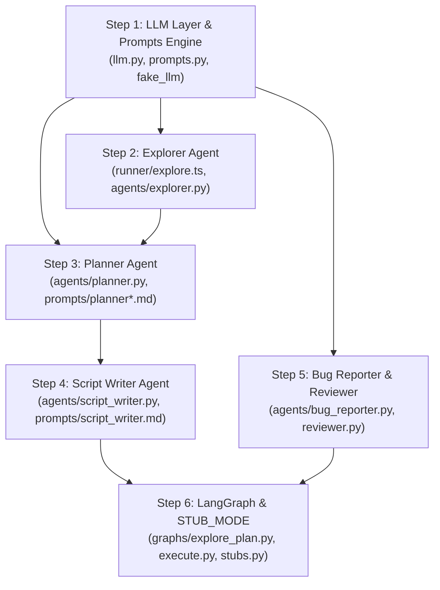

# Agentic Engineer Implementation Plan: Autonomous AI QA Brain

**Document:** `docs/agentic_implementation.md`  
**Role:** Agentic AI Engineer (Track B)  
**Target Delivery:** Complete multi-agent cognitive pipeline, prompt engineering layer, and LangGraph orchestration.  
**Git Branch:** `track-b/agents-graphs`

---

## 1. Executive Summary & File Ownership

The Agentic Engineer builds the entire "cognitive engine" of KAWACH. While Backend 1 provides the API/UI bridge and Backend 2 handles Playwright execution and the target application sandbox, the Agentic Engineer is responsible for:
1. **LLM Abstraction & Prompt Engine** (Multi-provider, defensive JSON parsing, disk caching, cost accounting, untrusted data wrapping).
2. **Explorer Agent** (TypeScript Playwright crawler + LLM feature summarizer producing `app_map.json`).
3. **Planner Agent** (Spec-aligned test catalog designer producing `catalog.json` with 100% spec coverage guarantee).
4. **Script Writer Agent** (Autonomous Playwright TypeScript test generator with syntax check and auto-healing).
5. **Autonomous Reviewer Agent** (LLM quality gate evaluating test proposals).
6. **Bug Reporter Agent** (Failure log & console synthesis into developer-grade defect reports).
7. **LangGraph Pipeline Orchestration** (Stateful execution graphs for Explore-Plan and Execute, plus deterministic `STUB_MODE`).

### Strict File Ownership (Exclusive Write)
```
backend/app/
├── llm.py                         # Single LLM access layer
├── prompts.py                     # Prompt loader, guard & untrusted wrapper
├── prompts/
│   ├── _guard.md                  # Prompt-injection defense text
│   ├── explore_summary.md         # App map summarization prompt
│   ├── planner.md                 # Test catalog generation prompt
│   ├── planner_single.md          # Ad-hoc human prompt test generation
│   ├── script_writer.md           # Playwright script generation prompt
│   ├── reviewer.md                # Autonomous catalog review prompt
│   └── bug_reporter.md            # Defect report generation prompt
├── fake_llm/
│   ├── _example.json              # Minimal test stub
│   ├── explore_summary.json       # Canned app map summary
│   ├── planner_catalog.json       # Canned 11 tests covering demo spec
│   ├── planner_single.json        # Canned single test
│   ├── script_writer.txt          # Canned valid Playwright script
│   └── bug_report.json            # Canned defect report
├── agents/
│   ├── explorer.py                # Python wrapper for crawler + LLM summary
│   ├── planner.py                 # plan_catalog & plan_single_test
│   ├── script_writer.py           # write_scripts with code fixer & retry
│   ├── reviewer.py                # review_catalog for autonomous mode
│   └── bug_reporter.py            # write_bug_reports
├── graphs/
│   ├── __init__.py                # run_explore_plan, run_execute, run_pipeline
│   ├── explore_plan.py            # Graph 1 (explore -> plan -> review_gate)
│   ├── execute.py                 # Graph 2 (scripts -> run -> triage -> bugs -> verify -> report)
│   └── stubs.py                   # STUB_MODE simulating full runs from samples
scripts/
└── dump_graphs.py                 # Exports Mermaid diagrams for documentation/demo
runner/
└── explore.ts                     # Standalone Playwright crawler script
```

---

## 2. Step-by-Step Implementation Sequence



---

### Step 1: LLM Layer & Prompt Guardrails (`Prompt B1`)
**Files:** `backend/app/llm.py`, `backend/app/prompts.py`, `backend/app/fake_llm/`

#### 1. `backend/app/prompts.py`
- `load_prompt(name: str, **vars: Any) -> str`: Loads `backend/app/prompts/<name>.md`. Replaces `{{var}}` placeholders. Raises `KeyError` if any `{{...}}` remains unreplaced or if extra variables were passed.
- `untrusted(text: str, label: str) -> str`: Wraps untrusted target app text (HTML, headings, error messages, console logs) in:
  ```markdown
  <untrusted_content label="{label}">
  {sanitized_text}
  </untrusted_content>
  ```
  Sanitizes any embedded `</untrusted_content>` tags into `[removed]` to prevent jailbreaking.
- `guard() -> str`: Returns the contents of `backend/app/prompts/_guard.md`.

#### 2. `backend/app/llm.py`
- **Class `LLM`**:
  - `complete_json(*, system, prompt, schema_name, run_id=None, max_tokens=4000, temperature=0.2) -> dict | list`
  - `complete_text(*, system, prompt, schema_name="text", run_id=None, max_tokens=2000, temperature=0.2) -> str`
- **Supported Providers:**
  - `anthropic`: Official Anthropic Python SDK using `settings.llm_model`.
  - `openai`: Official OpenAI SDK (`chat.completions.create` with JSON mode support and `max_completion_tokens` fallback).
  - `fake`: Zero-network mock. Reads canned response from `backend/app/fake_llm/<schema_name>.json` (or `.txt`). Enables 100% testability offline.
- **Defensive JSON Extraction:** Strips Markdown fences (` ```json `), finds substring between outer `{...}` or `[...]`, runs `json.loads`. If it fails, makes **one repair call** instructing the LLM to fix the invalid JSON.
- **Disk Cache:** File-backed cache in `backend/.llm_cache/` keyed by SHA256 of call parameters. Supports modes: `on` (read/write), `readonly`, and `off`.
- **Atomic Cost & Token Accounting:** Updates `runs/<run_id>/llm_usage.json` atomically with thread locks, calculating input/output tokens and cost in USD.

---

### Step 2: The Explorer Agent (`Prompt B2`)
**Files:** `runner/explore.ts`, `backend/app/agents/explorer.py`, `backend/app/prompts/explore_summary.md`

#### 1. Crawler Engine (`runner/explore.ts`)
- Standalone Playwright script executed via `npx tsx explore.ts`.
- **Safety First:** Request interception aborts and logs any HTTP request whose domain is not in `ALLOWED_HOSTS`.
- **Authentication Discovery:**
  - Looks for `<form>` containing `input[type="password"]` on base URL or `/login`, `/signin`.
  - Records the login page as `PageInfo` first.
  - Automatically fills `TEST_USERNAME` and `TEST_PASSWORD`, clicks submit, and confirms login success.
- **Breadth-First Search (BFS) Navigation:**
  - Navigates strictly within `BASE_URL` origin.
  - Skips destructive links (matching `/logout|signout|delete|remove/i` or `/__*`).
  - **Never clicks action buttons or submits data forms** during crawl; only follows `<a href="...">` links.
- **Metadata Extraction:**
  - Per-page HTTP status, title, headings (H1–H3), visible links (max 40), buttons (max 20), form fields (ARIA roles, labels, types, names), console errors.
  - Post-crawl unauthenticated probe to determine `requiresAuth`.
- **Budget Protection:** Respects `MAX_PAGES` (default 10) and `EXPLORE_SECONDS` (default 90s). Outputs `explore_raw.json`.

#### 2. Python Orchestrator (`backend/app/agents/explorer.py`)
- Sets run stage to `exploring`.
- Spawns `explore.ts` via subprocess, streaming line-by-line stdout progress (`PAGE n/max path`) to update `run.json` progress for the UI.
- Reads `explore_raw.json` and runs 1 LLM call using `explore_summary.md` to produce a high-level summary and 3–8 key feature groups.
- Persists final `app_map.json`.

---

### Step 3: Test Planner Agent (`Prompt B3`)
**Files:** `backend/app/agents/planner.py`, `backend/app/prompts/planner.md`, `backend/app/prompts/planner_single.md`

#### 1. Full Catalog Generation (`plan_catalog`)
- Sets stage to `planning`.
- Prompt feeds:
  - App map (compact JSON wrapped in `<untrusted_content>`).
  - QA background prompt.
  - Specification sheet (`S1: ...`, `S2: ...`).
- **Strict Quality Rules Enforced by Prompt:**
  1. Generate 8 to 12 tests.
  2. Every spec item must be covered by at least one test (`specRef`).
  3. Tests must be independent and create their own fresh data.
  4. Steps must use concrete UI labels and paths discovered in `app_map.json`.
  5. Expected results must quote the specification text verbatim.
- **Code-Side Validation & Auto-Healing:**
  - Parses LLM output against Pydantic model `TestCase`.
  - Checks set difference between required spec IDs and covered spec IDs.
  - If coverage is incomplete: Triggers **one targeted LLM retry** asking for the missing items.
  - If still missing: Auto-generates deterministic fallback tests (`Verify: S{id}`).
- Saves valid `catalog.json` with tests in status `proposed`.

#### 2. Ad-hoc Test Generation (`plan_single_test`)
- Allows human QA engineers to add custom tests during review by entering natural language prompts (e.g., *"Check that password field masks characters"*).
- Generates a single concrete `TestCase`, assigns next sequential ID (`T12`), and appends to `catalog.json`.

---

### Step 4: Playwright Script Writer Agent (`Prompt B4`)
**Files:** `backend/app/agents/script_writer.py`, `backend/app/prompts/script_writer.md`

#### 1. Script Generation Engine (`write_scripts`)
- Iterates over all tests in `catalog.json` with status `approved`.
- For each test, calls LLM with `script_writer.md` asking for a single self-contained Playwright test.
- **Hard Code-Side Sanitization:**
  - Enforces import line: `import { test, expect, credentials, unique } from '../../../runner/fixtures';`.
  - Fixes test title: `test('T02: ...', async ({ page }) => { ... });`.
  - Rejects dangerous/flaky patterns: `waitForTimeout`, `test.skip`, `require(`, `process.env`, absolute external URLs, or raw CSS/XPath selectors.
- **Pre-Execution Lint & Syntax Validation:**
  - Runs `runner_client.list_tests(run_id, script_path)` (or fallback `npx playwright test <file> --list`).
  - If syntax or import error occurs: Sends compiler error back to the LLM for **one auto-repair attempt**.
  - Marks test `scriptStatus="ok"` or `scriptStatus="error"` (with error message preserved).
- Writes scripts to `runs/<run_id>/scripts/<TestId>.spec.ts`.

---

### Step 5: Bug Reporter & Autonomous Reviewer (`Prompt B6`, FR-5)
**Files:** `backend/app/agents/bug_reporter.py`, `backend/app/agents/reviewer.py`, `backend/app/prompts/bug_reporter.md`

#### 1. Bug Reporter Agent (`write_bug_reports`)
- Inputs: Assertion failure outputs triaged by Backend 2, stack traces, console errors, and catalog test definitions.
- Generates structured defect report for developers:
  - `title`: Specific present-tense bug statement (e.g., *"Signup accepts email address without @ symbol"*).
  - `category`: `validation | auth | data | navigation | console | network | ui | other`.
  - `severity`: `critical | high | medium | low`.
  - `steps`: 3 to 8 clear reproduction steps.
  - `expected` & `actual`: Exact mismatch quoting spec expectation vs actual UI/system state.
- Updates `bugs.json`.

#### 2. Autonomous Reviewer Agent (`review_catalog`)
- Used when run mode is `autonomous`.
- Evaluates each proposed test in `catalog.json` against the spec sheet.
- Sets test status to `approved` or `rejected`, writing justifications into `review_log.json`.

---

### Step 6: LangGraph Workflows & STUB_MODE (`Prompt B5`)
**Files:** `backend/app/graphs/explore_plan.py`, `backend/app/graphs/execute.py`, `backend/app/graphs/stubs.py`, `backend/app/graphs/__init__.py`

#### 1. Graph 1: Explore & Plan (`explore_plan.py`)
```
[START] ──► explore ──► plan ──► review_gate ──► [END]
```
- `explore`: Calls `explorer.run_explorer(run_id)`.
- `plan`: Calls `planner.plan_catalog(run_id)`.
- `review_gate`:
  - **Manual mode:** Sets stage `awaiting_review` and halts graph.
  - **Autonomous mode:** Calls `reviewer.review_catalog(run_id)`, approves tests, and transitions to Graph 2.

#### 2. Graph 2: Execute & Verify (`execute.py`)
```
[START] ──► write_scripts ──► run_tests ──► report_bugs ──► verify ──► build_report ──► [END]
```
- `write_scripts`: Generates `.spec.ts` files.
- `run_tests`: Calls Backend 2's runner and triage.
- `report_bugs`: Calls `bug_reporter.write_bug_reports(run_id)`.
- `verify`: Calls Backend 2's `verifier.verify_all(run_id)`.
- `build_report`: Calls Backend 1's report builder; transitions run stage to `done`.

#### 3. Error Resilience Decorator (`safe_node`)
- Every graph node is wrapped with `safe_node`.
- Traps unhandled exceptions, logs traceback to `runs/<run_id>/error.log`, calls `storage.fail_run()`, and safely exits to `END`.

#### 4. STUB_MODE Simulation (`stubs.py`)
- If `settings.stub_mode == True`:
  - Emulates stage execution using contracts in `contracts/samples/`.
  - Introduces 1–2 second simulated delays with realistic stage progress updates.
  - Enables full frontend and API validation without running Chromium or burning LLM credits.

---

## 3. High-Level Demo Walkthrough (The 8 Beats)

When the complete system is assembled and demonstrated, the agentic components drive the core narrative:

| Beat | Stage | System Action | What Judges/Users See on UI |
| :---: | :--- | :--- | :--- |
| **1** | **Submission** | User enters target app URL (`http://localhost:4000`), spec sheet, and clicks **Start Run**. | Input validated; stage transitions to `exploring`. |
| **2** | **Exploration** | Playwright crawler navigates routes; LLM summarizes app structure. | Live log stream displays discovered pages (`/login`, `/dashboard`, `/settings`) and visual site map. |
| **3** | **Planning** | Planner generates 11 tests mapping to spec requirements `S1`..`S11`. | Test Catalog table populates with priorities, steps, and spec tags. |
| **4** | **Review Gate** | User reviews catalog, edits title, or adds test via prompt (`plan_single_test`), then clicks **Approve & Execute**. | Stage transitions to `scripting`; run enters Graph 2. |
| **5** | **Script Gen** | Script Writer produces Playwright `.spec.ts` files with code validation. | Progress bar advances as scripts are compiled and verified. |
| **6** | **Execution** | Playwright runs tests in parallel; assertions catch planted bugs. | Live execution dashboard reflects real-time test passes/failures. |
| **7** | **Defect Analysis** | Bug Reporter generates reproduction steps; Verifier replays bugs 3x. | Bug cards display severity badges, stack traces, and `confirmed` (3/3) vs `flaky` (2/3) status. |
| **8** | **Final Report** | Executive report and metrics generated. | High-level pass rate, defect summary, and downloadable Markdown report. |

---

## 4. Verification & Testing Commands

To prove all agentic modules work independently before merging:

1. **Verify LLM & Caching:**
   ```bash
   cd backend
   python -m pytest tests/test_llm.py -q
   LLM_PROVIDER=fake python -c "from app.llm import get_llm; print(get_llm().complete_json(system='s', prompt='p', schema_name='_example'))"
   ```

2. **Verify Test Planner:**
   ```bash
   cd backend
   python -m pytest tests/test_planner.py -q
   ```

3. **Verify Script Writer:**
   ```bash
   cd backend
   python -m pytest tests/test_script_writer.py -q
   ```

4. **Verify STUB_MODE Pipeline:**
   ```bash
   cd backend
   STUB_MODE=1 python -c "from app.graphs import run_pipeline; run_pipeline('test-stub-run')"
   ```
