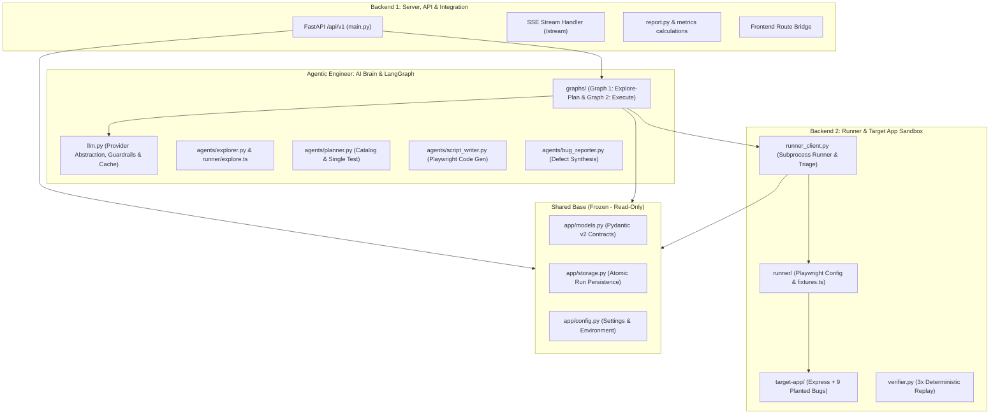

# 3-Person Engineering Workflow & Work Distribution

This workflow is optimized for a 3-person team (**Backend 1**, **Backend 2**, and **Agentic Engineer**) working concurrently on the Autonomous AI QA Engineer platform. 

The frontend (Next.js 16 / React 19) is already built in the workspace. The team's mission is to build the backend server, the Playwright execution sandbox with the planted-bug target app, and the multi-agent AI brain using LangGraph.

---

## 🏗️ System Architecture & Responsibility Flow



---

## 📁 Strict File Ownership & Boundaries

To ensure **zero Git merge conflicts**, no two engineers ever write to the same file.

| Engineer | Focus Area | Exclusive Write Ownership | Shared Read-Only Dependencies |
| :--- | :--- | :--- | :--- |
| **Shared Base** *(Completed)* | **Foundation** | *Frozen on `main`:*<br>• [backend/app/models.py](file:///d:/Soham/Vit%20Hackathon/vithackie/backend/app/models.py)<br>• [backend/app/storage.py](file:///d:/Soham/Vit%20Hackathon/vithackie/backend/app/storage.py)<br>• [backend/app/config.py](file:///d:/Soham/Vit%20Hackathon/vithackie/backend/app/config.py)<br>• [contracts/types.ts](file:///d:/Soham/Vit%20Hackathon/vithackie/contracts/types.ts) | Everyone reads and imports without editing. |
| **Backend 1** | **FastAPI Server, API Routes & Reporting** | • [backend/app/main.py](file:///d:/Soham/Vit%20Hackathon/vithackie/backend/app/main.py)<br>• [backend/app/report.py](file:///d:/Soham/Vit%20Hackathon/vithackie/backend/app/report.py)<br>• `backend/app/api/**` (routers/routes if modularized) | [docs/API_CONTRACT.md](file:///d:/Soham/Vit%20Hackathon/vithackie/docs/API_CONTRACT.md)<br>[docs/p03.md](file:///d:/Soham/Vit%20Hackathon/vithackie/docs/p03.md)<br>[docs/p06.md](file:///d:/Soham/Vit%20Hackathon/vithackie/docs/p06.md) (C4, C5) |
| **Backend 2** | **Target App, Playwright Engine & Verifier** | • `target-app/**`<br>• `runner/**` (*except* `explore.ts`)<br>• [backend/app/runner_client.py](file:///d:/Soham/Vit%20Hackathon/vithackie/backend/app/runner_client.py)<br>• [backend/app/verifier.py](file:///d:/Soham/Vit%20Hackathon/vithackie/backend/app/verifier.py) | [docs/p04.md](file:///d:/Soham/Vit%20Hackathon/vithackie/docs/p04.md) (Prompt A)<br>[docs/p06.md](file:///d:/Soham/Vit%20Hackathon/vithackie/docs/p06.md) (C1, C2, C3)<br>[docs/CONTRACTS.md](file:///d:/Soham/Vit%20Hackathon/vithackie/docs/CONTRACTS.md) |
| **Agentic Engineer** | **AI Brain, Prompts & LangGraph Pipelines** | • [backend/app/llm.py](file:///d:/Soham/Vit%20Hackathon/vithackie/backend/app/llm.py)<br>• `backend/app/prompts/**`<br>• `backend/app/agents/**`<br>• `backend/app/graphs/**`<br>• `backend/app/fake_llm/**`<br>• `runner/explore.ts` | [docs/p04.md](file:///d:/Soham/Vit%20Hackathon/vithackie/docs/p04.md) (B1, B2)<br>[docs/p05.md](file:///d:/Soham/Vit%20Hackathon/vithackie/docs/p05.md) (B3, B4, B5, B6)<br>[docs/CONTRACTS.md](file:///d:/Soham/Vit%20Hackathon/vithackie/docs/CONTRACTS.md) |

---

## 🤝 Parallel Interface Agreements (Zero-Blocker Contracts)

To allow each person to build and test 100% independently without waiting for each other:

### 1. Interface: Agentic Engineer ➔ Backend 2 (`runner_client.list_tests`)
* **Contract:** The Script Writer agent calls `runner_client.list_tests(run_id: str, file: str) -> ListResult`.
* **Parallel Fallback:** While Backend 2 is building `runner_client.py`, the Agentic Engineer can use `_list_tests_fallback` using `npx playwright test <file> --list` (already provided in Prompt B4). They do not need to wait for Backend 2.

### 2. Interface: Backend 1 ➔ Agentic Engineer (`graphs/` Execution)
* **Contract:** Backend 1's API endpoints trigger `graphs.run_explore_plan(run_id: str)` in background tasks, and `graphs.run_execute(run_id: str)`.
* **Parallel Fallback:** While the Agentic Engineer is building LangGraph, Backend 1 sets `STUB_MODE=1` in `.env`. When stub mode is active, the endpoints simply copy the sample JSON files from `contracts/samples/` directly into `runs/<run_id>/` using `storage.py`. Backend 1 can fully test the Next.js UI integration immediately.

### 3. Interface: Backend 1 ➔ Next.js Frontend (API Route & Schema Alignment)
* **Contract:** Next.js proxies all requests to `http://localhost:8000/api/*` via `next.config.ts`. The frontend expects `/api/v1/*` routes (detailed in [docs/API_CONTRACT.md](file:///d:/Soham/Vit%20Hackathon/vithackie/docs/API_CONTRACT.md)).
* **Resolution:** Backend 1 mounts all endpoints under `/api/v1` in `backend/app/main.py`. For model serialization, Backend 1 uses the models in `backend/app/models.py`. If a frontend component expects an extra view helper (like `workers_up` in health check or the SSE stream), Backend 1 implements it directly in `main.py` using `storage.py`.

---

## 👨‍💻 Detailed Task Sequences

### 1. Backend Engineer 1: Server Core, API & Reporting
* **Branch:** `track-c/api-core`
* **Docs:** [docs/API_CONTRACT.md](file:///d:/Soham/Vit%20Hackathon/vithackie/docs/API_CONTRACT.md), [docs/p06.md](file:///d:/Soham/Vit%20Hackathon/vithackie/docs/p06.md) (Prompt C4, C5)
* **Step-by-step Tasks:**
  1. **FastAPI Setup ([backend/app/main.py](file:///d:/Soham/Vit%20Hackathon/vithackie/backend/app/main.py)):**
     - Add route prefix `/api/v1` and ensure CORS allows `http://localhost:3000` and `http://localhost:5173`.
     - Implement `GET /api/v1/health` returning `status`, `workers_up`, and `message`.
     - Implement `GET /api/v1/config/defaults` reading from `config.settings`.
  2. **Run Management Endpoints:**
     - `POST /api/v1/runs/start`: Validates target URL against `ALLOWED_HOSTS`, creates a run ID via `storage.new_run_id()`, writes `input.json` and `run.json`, spawns background pipeline execution.
     - `GET /api/v1/runs`: Returns run list using `storage.list_runs()`.
     - `GET /api/v1/runs/{id}`: Returns `RunView` using `storage.load_model`.
  3. **Interactive Review Gate & Catalog:**
     - `PUT /api/v1/runs/{id}/catalog`: Updates catalog tests if stage is `awaiting_review`.
     - `POST /api/v1/runs/{id}/catalog/approve-and-execute` (or `POST /api/v1/runs/{id}/execute`): Marks non-rejected tests as approved and resumes Graph 2 in the background.
     - `POST /api/v1/runs/{id}/tests`: Adds a single test case to the catalog.
  4. **Live Stream & Reports:**
     - `GET /api/v1/runs/{id}/stream`: SSE endpoint checking `storage.get_run(id)` every 1s and yielding `stage_change` or log events.
     - `GET /api/v1/runs/{id}/report`: Returns markdown generated by `report.build_report(id)`.
     - `GET /api/v1/runs/{id}/files/{path:path}`: Serves screenshots, videos, or scripts safely from `runs/<id>/`.
  5. **Metrics Engine ([backend/app/report.py](file:///d:/Soham/Vit%20Hackathon/vithackie/backend/app/report.py)):**
     - Implement `build_metrics(run_id)`: Aggregates test counts, bug statuses (confirmed/flaky/not_reproduced), wall clock time, and writes `metrics.json`.
     - Implement `build_report(run_id)`: Formats Markdown report table with defects, replays, and coverage.

---

### 2. Backend Engineer 2: Target App & Execution Sandbox
* **Branch:** `track-a/sandbox-runner`
* **Docs:** [docs/p04.md](file:///d:/Soham/Vit%20Hackathon/vithackie/docs/p04.md) (Prompt A), [docs/p06.md](file:///d:/Soham/Vit%20Hackathon/vithackie/docs/p06.md) (Prompt C1, C2, C3)
* **Step-by-step Tasks:**
  1. **Demo Target App (`target-app/`):**
     - Build Node/Express web app running on port 4000:
       - Pages: `/signup`, `/login`, `/dashboard`, `/settings`, `/logout`.
       - Memory store with seed user `qa.tester@example.com` / `Passw0rd!23`.
       - Add `GET|POST /__reset` to wipe state between runs.
       - Add `GET /__bugs` listing active planted bug IDs.
     - Plant the 9 specified defects (GT01–GT09) with switchable toggle `BUGS_OFF` env var:
       - Invalid email accepted, short password accepted, missing error on wrong password, uppercase email failure, empty item accepted, delete removes wrong item, cached dashboard after logout, settings console error, and flaky save (every 2nd save fails).
     - Save `target-app/spec.md` and `target-app/ground_truth.json`.
  2. **Playwright Runner Engine (`runner/`):**
     - Implement `runner/fixtures.ts`:
       - Custom fixture tracking console errors, page errors, failed HTTP 4xx/5xx requests.
       - Abort off-domain network requests and log to `blocked_requests.jsonl`.
       - Export helper `unique(prefix)` and `credentials`.
     - Configure `runner/playwright.config.ts` with environment overrides (`BASE_URL`, `OUTPUT_DIR`, `WORKERS`, `TEST_TIMEOUT_MS`).
  3. **Subprocess Client & Triage ([backend/app/runner_client.py](file:///d:/Soham/Vit%20Hackathon/vithackie/backend/app/runner_client.py)):**
     - `run_playwright(...)`: Executes Playwright CLI in `runner/`, captures stdout/stderr, reports, and stores evidence into `runs/<id>/evidence/<TestId>/` (`screenshot.png`, `video.webm`, `trace.zip`, `console.json`, `network.json`).
     - `list_tests(run_id, file)`: Executes `playwright test <file> --list` to check script validity.
     - `is_assertion_failure(error_message)`: RegEx pattern matching `expect().to*` while excluding timeouts.
     - `triage(run_id)`: Filters assertion failures into bug candidates in `bugs.json` and classifies execution crashes into test errors in `results.json`.
  4. **3x Deterministic Bug Verifier ([backend/app/verifier.py](file:///d:/Soham/Vit%20Hackathon/vithackie/backend/app/verifier.py)):**
     - `verify_bug(run_id, bug_id)`: Replays each candidate bug 3 times using `npx playwright test <file> -g "<grep>" --retries=0`.
     - Classifies status: `confirmed` (3/3), `flaky` (1/3 or 2/3), `not_reproduced` (0/3).
     - Writes `verification/<bugId>.json` and updates `bugs.json`.

---

### 3. Agentic Engineer: AI Brain, Prompts & LangGraph Pipelines
* **Branch:** `track-b/agents-graphs`
* **Docs:** [docs/p04.md](file:///d:/Soham/Vit%20Hackathon/vithackie/docs/p04.md) (Prompt B1, B2), [docs/p05.md](file:///d:/Soham/Vit%20Hackathon/vithackie/docs/p05.md) (Prompt B3, B4, B5, B6)
* **Step-by-step Tasks:**
  1. **LLM Abstraction & Prompt Engine ([backend/app/llm.py](file:///d:/Soham/Vit%20Hackathon/vithackie/backend/app/llm.py), [backend/app/prompts.py](file:///d:/Soham/Vit%20Hackathon/vithackie/backend/app/prompts.py)):**
     - Implement `LLM` class supporting Anthropic, OpenAI, and `fake` provider.
     - Add file-backed prompt caching in `backend/.llm_cache/` and cost calculation in `LlmUsage`.
     - Implement `prompts.untrusted(text, label)` injecting `<untrusted_content>` tags and security guardrail `backend/app/prompts/_guard.md`.
     - Populate canned responses in `backend/app/fake_llm/` for offline/fake provider testing.
  2. **Explorer Agent ([backend/app/agents/explorer.py](file:///d:/Soham/Vit%20Hackathon/vithackie/backend/app/agents/explorer.py), `runner/explore.ts`):**
     - Write `runner/explore.ts`: BFS crawler discovering same-origin forms and links without clicking destructive buttons.
     - `run_explorer(run_id)` executes crawler, runs LLM summary prompt (`prompts/explorer.md`), and saves `app_map.json`.
  3. **Planner Agent ([backend/app/agents/planner.py](file:///d:/Soham/Vit%20Hackathon/vithackie/backend/app/agents/planner.py)):**
     - `plan_catalog(run_id)`: Prompt loads `app_map.json` and `specRaw`. LLM generates 8–12 concrete test cases quoting exact spec lines.
     - Validates against `TestCase` model, guarantees 100% `specRef` coverage with retry/fallback, and saves `catalog.json`.
     - `plan_single_test(run_id, user_prompt)`: Handles user prompt additions during catalog review.
  4. **Script Writer Agent ([backend/app/agents/script_writer.py](file:///d:/Soham/Vit%20Hackathon/vithackie/backend/app/agents/script_writer.py)):**
     - `write_scripts(run_id)`: Loops over approved test cases. LLM writes executable TypeScript tests importing from `../../../runner/fixtures`.
     - Validates scripts via `list_tests`, retries once on error, and saves `runs/<id>/scripts/<TestId>.spec.ts`.
  5. **Bug Reporter Agent ([backend/app/agents/bug_reporter.py](file:///d:/Soham/Vit%20Hackathon/vithackie/backend/app/agents/bug_reporter.py)):**
     - `write_bug_reports(run_id)`: Takes triage assertion failures, extracts error context, and generates clean reproducible bug write-ups.
  6. **LangGraph Pipeline ([backend/app/graphs/\_\_init\_\_.py](file:///d:/Soham/Vit%20Hackathon/vithackie/backend/app/graphs/__init__.py)):**
     - **Graph 1 (`run_explore_plan`)**: `explore` ➔ `plan` ➔ `awaiting_review`.
     - **Graph 2 (`run_execute`)**: `write_scripts` ➔ `run_tests` ➔ `triage` ➔ `report_bugs` ➔ `verify` ➔ `build_report` ➔ `done`.
     - Implement `STUB_MODE=1` handling: Copies sample data from `contracts/samples/` if enabled.

---

## 🚀 Git Operations & Zero-Conflict Integration Protocol

### Step 1: Branch Creation (All 3 Engineers)
Since the workspace currently has the complete Phase 0 skeleton, commit `phase0/skeleton` to `main` first. Each engineer branches off up-to-date `main`:

```bash
# Backend 1
git checkout main
git pull origin main
git checkout -b track-c/api-core

# Backend 2
git checkout main
git pull origin main
git checkout -b track-a/sandbox-runner

# Agentic Engineer
git checkout main
git pull origin main
git checkout -b track-b/agents-graphs
```

### Step 2: Commits & Daily Rules
1. **Never edit outside your owned files.** (Check the table above before creating or modifying any file).
2. **Never commit `.env` or `runs/`** (These are git-ignored).
3. **Commit frequently with clear prefixes:**
   - `git commit -m "feat(api): add runs start and list endpoints"`
   - `git commit -m "feat(runner): implement custom fixture and route blocking"`
   - `git commit -m "feat(planner): catalog generation with spec coverage fallback"`

### Step 3: Sequential Integration Merge Order (Phase 2 Stitching)
Do **NOT** merge all 3 branches to `main` at the same time. Follow this exact sequence:

```
[Target App & Runner] ──────► 1. Merge Backend 2 (track-a/sandbox-runner)
                                       │
                                       ▼
[Agents & LangGraph]  ──────► 2. Rebase & Merge Agentic Engineer (track-b/agents-graphs)
                                 (Wires Graph to real RunnerClient & TargetApp)
                                       │
                                       ▼
[API Server & UI]     ──────► 3. Rebase & Merge Backend 1 (track-c/api-core)
                                 (FastAPI calls ready Graphs and streams results)
```

1. **Merge Backend 2 first:**
   Backend 2 merges `track-a/sandbox-runner` into `main`. The target app (port 4000) and Playwright runner are now live on `main`.
2. **Merge Agentic Engineer second:**
   Agentic Engineer runs `git fetch origin && git rebase origin/main` on `track-b/agents-graphs`. They verify that the explorer and runner client execute against the live target app, then merge to `main`.
3. **Merge Backend 1 third:**
   Backend 1 runs `git fetch origin && git rebase origin/main` on `track-c/api-core`. They wire FastAPI route triggers directly into the completed `graphs.run_explore_plan()` and `graphs.run_execute()`, and verify end-to-end with the Next.js UI.

---

## 🧪 Pre-Merge Sanity Checks for Each Person

Before opening a pull request to `main`, run your verification checks:

* **Backend 1:**
  ```bash
  cd backend && python -m pytest tests/ -q
  # Verify Swagger UI responds at http://localhost:8000/docs
  ```
* **Backend 2:**
  ```bash
  cd target-app && npm start &
  cd runner && npx playwright test
  # Verify 3x replay on verifier.py
  ```
* **Agentic Engineer:**
  ```bash
  cd backend && python -c "from app import config, models, storage, llm, prompts; from app.agents import explorer, planner, script_writer, reviewer, bug_reporter; from app import graphs; print('all agents import cleanly')"
  # Run planner & script-writer unit tests with LLM_PROVIDER=fake
  ```